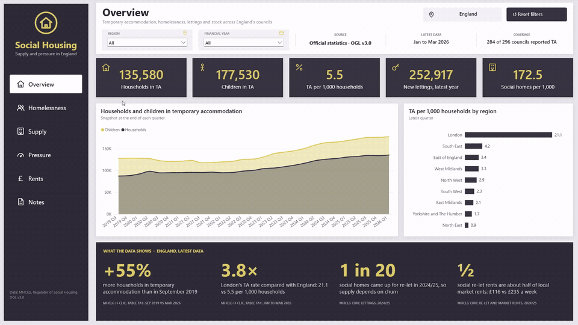
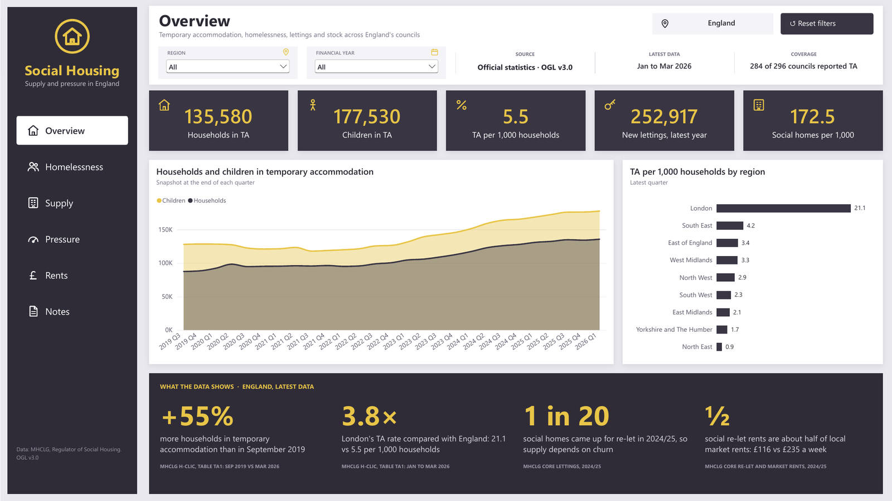
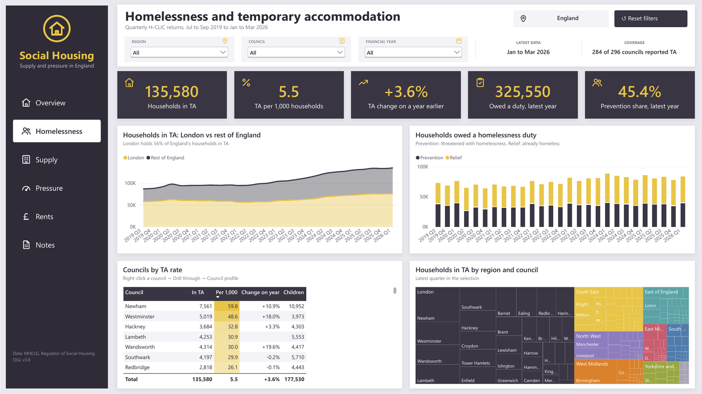
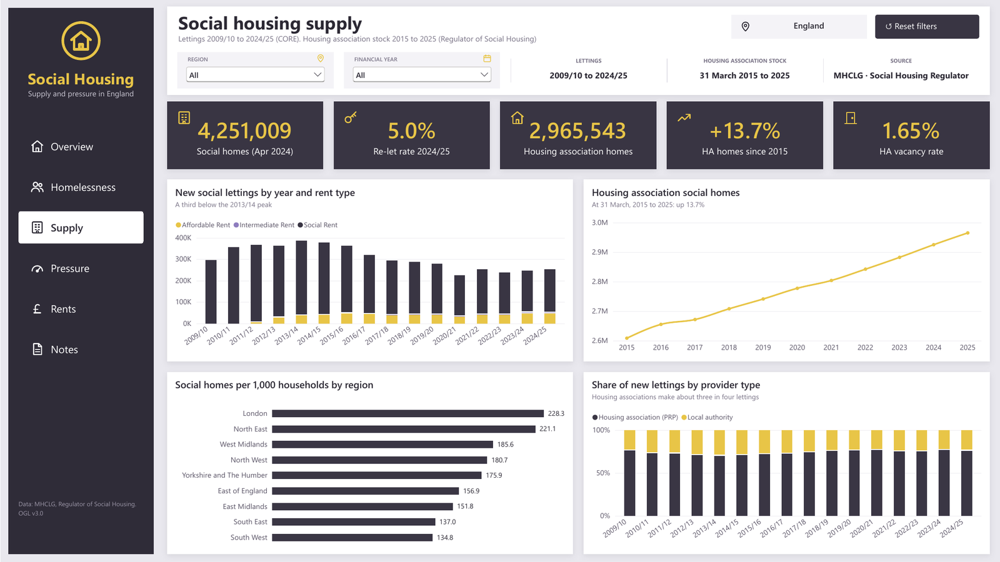
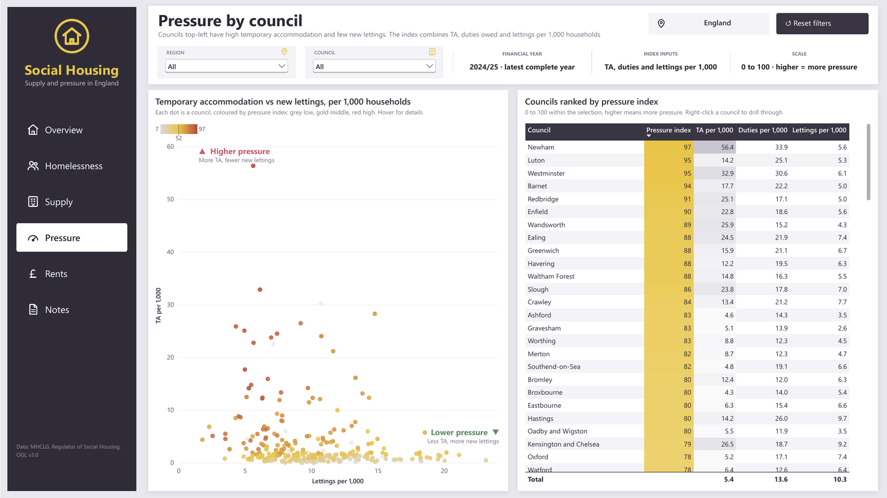
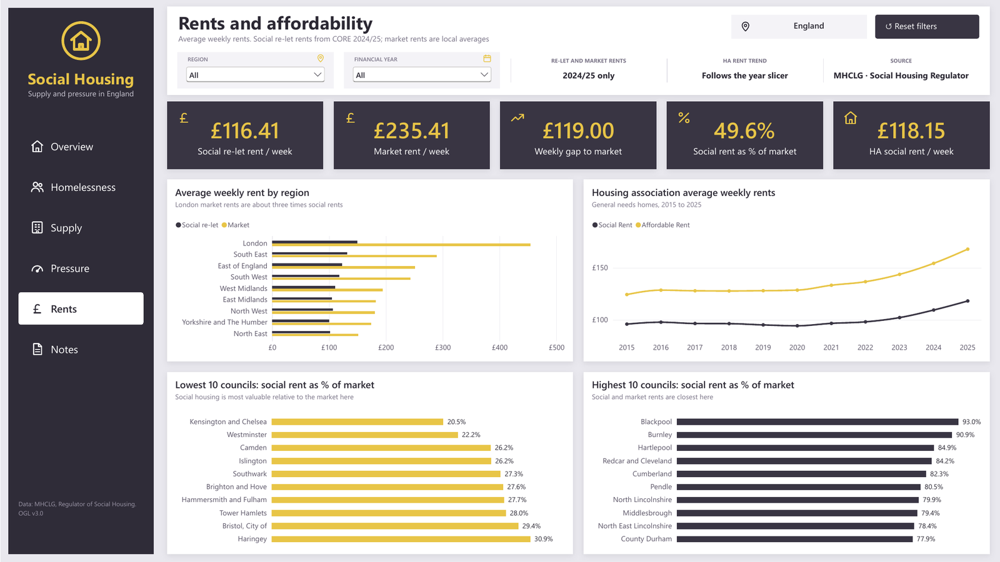
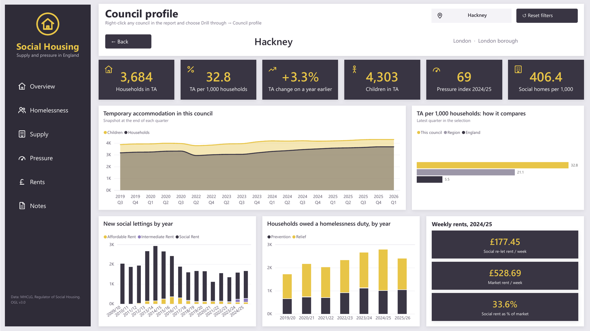
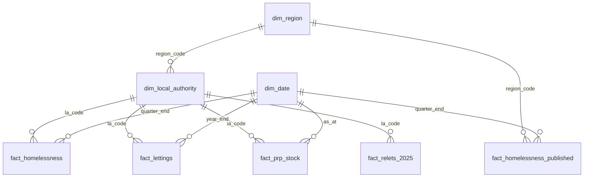

# Social housing supply and pressure in England, by local authority

A Power BI dashboard comparing how much social housing each English council area has, how much of it comes up for letting, and how much pressure is building in homelessness and temporary accommodation. The data is built by a reproducible Python pipeline from official statistics, reconciled back to the published totals.



The full report is also available as a [PDF](docs/SocialHousingPressure.pdf).

| | |
|---|---|
|  |  |
|  |  |
|  |  |

## Key findings

* 135,580 households were in temporary accommodation in England at the end of March 2026, up 3.6% on a year earlier and 55% higher than in September 2019. Nearly two thirds (63.8%) include children; 177,530 children in total.
* London has about 21 households in temporary accommodation per 1,000, almost four times the England rate of 5.5. In Newham the figure is around 60 per 1,000. On a combined pressure index (temporary accommodation, homelessness duties and lettings per household in 2024/25), nine of the ten highest-scoring councils are London boroughs; Luton is the exception.
* Only about 5% of England's 4.25 million social homes were re-let in 2024/25. New lettings (around 253,000 in the council-level data) are a third below their 2013/14 peak, even though housing association stock grew 13.7% between 2015 and 2025.
* Social rents are about half of market rents: the average social re-let rent in 2024/25 was £116 a week, against a local market average of £235.

## Data model



| Table | Grain | Coverage |
|---|---|---|
| fact_homelessness | council x quarter | Jul to Sep 2019 to Jan to Mar 2026 |
| fact_homelessness_published | England or region x quarter | same |
| fact_lettings | council x year x rent, needs and provider type | 2009/10 to 2024/25 |
| fact_prp_stock | council x year (31 March) | 2015 to 2025 |
| fact_relets_2025 | council | 2024/25 |

Full column definitions are in [docs/data_dictionary.md](docs/data_dictionary.md).

## Sources

All published on GOV.UK under the [Open Government Licence v3.0](https://www.nationalarchives.gov.uk/doc/open-government-licence/version/3/).

* MHCLG, [Statutory homelessness detailed local authority tables](https://www.gov.uk/government/statistical-data-sets/live-tables-on-homelessness) (H-CLIC), tables A1 and TA1, quarterly
* MHCLG, [Social housing lettings in England, April 2024 to March 2025](https://www.gov.uk/government/statistics/social-housing-lettings-in-england-april-2024-to-march-2025) (CORE), tables 1d and 1e
* Regulator of Social Housing, [Private registered provider social housing stock and rents in England 2024 to 2025](https://www.gov.uk/government/statistics/private-registered-provider-social-housing-stock-and-rents-in-england-2024-to-2025), local authority trend tool

## How to run

Python 3.10 or later.

```bash
pip install -r requirements.txt
python src/build_model.py      # downloads sources, builds data/processed/, runs validation
python src/validate.py         # re-run the checks on their own
```

The first run takes several minutes because the homelessness files are large .ods spreadsheets; parsed quarters are cached in `data/interim/`, so later runs take about a minute. To add a new quarter, add its URL to `HOMELESSNESS` in `src/config.py` and re-run.

The processed CSVs are committed, so you can open `powerbi/SocialHousingPressure.pbip` in Power BI Desktop without running Python. The report reads the CSVs from this repository's GitHub raw folder; to load a local copy instead, set the `DataFolder` parameter (Transform data > Edit parameters) to your `data\processed\` path, ending in a backslash, and refresh.

## Repository structure

```
src/
  config.py          source URLs and paths
  download.py        fetches source files into data/raw/
  homelessness.py    parses the quarterly homelessness tables
  core.py            CORE lettings, churn and rents
  prp.py             Regulator of Social Housing stock trend tool
  geography.py       council boundary harmonisation
  build_model.py     builds the star schema, then validates
  validate.py        reconciliation checks
data/processed/      model-ready CSVs (committed)
powerbi/
  SocialHousingPressure.pbip            Power BI project (open this)
  SocialHousingPressure.SemanticModel/  model as TMDL: tables, relationships, measures
  SocialHousingPressure.Report/         report pages and visuals as PBIR JSON
  theme.json                            report theme
docs/
  data_dictionary.md
  SocialHousingPressure.pdf             the full report as a PDF
  images/                               page images and walkthrough
```

## Caveats

* Missing homelessness returns: each quarter, anywhere from a handful to about 30 councils don't submit data. National and regional figures use MHCLG's published totals, which include estimates for them. Council-level rates are calculated only over councils that reported, and the report flags any selected council with a missing return.
* Lettings totals: council-level lettings are as published in CORE Table 1d, without the national adjustment for missing returns, so the 2024/25 total (252,917) is a little below MHCLG's headline estimate (about 263,000). Coverage in 2009/10 is also lower than later years.
* Housing association stock only: the 2015 to 2025 stock trend covers housing associations, not council-owned homes. Total social stock (council plus housing association) is available for 1 April 2024 only.
* Denominators: supply rates per 1,000 households use the latest household estimates; homelessness rates use each quarter's own estimate.
* Boundaries: all series are on April 2024 council boundaries; merged councils are the sum of their predecessors, and a merged area is blank in any quarter where a predecessor didn't report.
